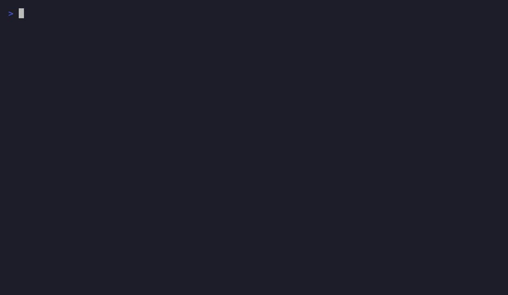

[简体中文](./README.zh-CN.md) · [Website](https://cachepin.lei6393.com) · [GitHub](https://github.com/SuperMarioYL/cachepin)

<picture>
  <source media="(max-width: 600px) and (prefers-color-scheme: dark)" srcset="./assets/presentation/hero-mobile-dark.svg">
  <source media="(max-width: 600px)" srcset="./assets/presentation/hero-mobile-light.svg">
  <source media="(prefers-color-scheme: dark)" srcset="./assets/presentation/hero-dark.svg">
  
</picture>

# cachepin

**See when a harness rewrites conversation history.**

CachePin tracks message prefixes between requests and optionally rewrites mutated histories into append-only extensions of its canonical history.

## Why use it

A reordered or rewritten early message changes the input prefix even when most of the conversation looks unchanged. Message-level tracking makes that mutation visible before you interpret cache behavior.

- **Locate mutation boundaries** — The common-prefix index points to the first changed message.
- **Inspect rewrite semantics** — Canonical history and appended suffix are explicit.
- **Use an HTTP boundary** — The proxy sits between a harness and its compatible endpoint.

## Architecture

<picture>
  <source media="(max-width: 600px) and (prefers-color-scheme: dark)" srcset="./assets/presentation/architecture-mobile-dark.svg">
  <source media="(max-width: 600px)" srcset="./assets/presentation/architecture-mobile-light.svg">
  <source media="(prefers-color-scheme: dark)" srcset="./assets/presentation/architecture-dark.svg">
  
</picture>

The proxy parses chat requests while preserving unknown fields. Session tracking hashes messages and finds the longest common prefix. In pin mode, reconciliation preserves the entire canonical history and appends the incoming suffix from the mutation boundary.

| Component | Responsibility |
| --- | --- |
| `Chat proxy` | internal/proxy |
| `Message tracker` | internal/session |
| `History reconciler` | internal/pin |
| `Prefix metrics` | internal/metrics |

## Install and quickstart

Build with the version declared in the repository manifest. Run the example from the repository root.

```bash
git clone https://github.com/SuperMarioYL/cachepin.git
cd cachepin
go build ./cmd/cachepin
```

Compare two explicit histories where an assistant answer changes, then print exactly what the production reconciler retains and appends.

```bash
go run ./examples/presentation-demo
```

## Recorded demo

<picture>
  <source media="(max-width: 600px) and (prefers-color-scheme: dark)" srcset="./assets/presentation/process-mobile-dark.svg">
  <source media="(max-width: 600px)" srcset="./assets/presentation/process-mobile-light.svg">
  <source media="(prefers-color-scheme: dark)" srcset="./assets/presentation/process-dark.svg">
  
</picture>

Reconciliation expands four incoming messages to five by retaining the old answer and appending the changed suffix.

```text
common prefix: 2 messages
rewritten: true
message count: 4 -> 5
0 system "Be precise."
1 user "Review code."
2 assistant "Original answer."
3 assistant "Corrected answer."
4 user "Continue."
```

The complete command and output are recorded in [docs/demo-results.json](./docs/demo-results.json). Inputs and reproduction code are included in the repository.



The existing recording is retained for context; the text example above documents the reproducible scenario.

## Usage

The CLI exposes the following operations. Commands after the example use your own paths or identifiers.

```bash
go run ./cmd/cachepin --upstream http://localhost:8080
# Enable only after reviewing append-only semantics:
go run ./cmd/cachepin --upstream http://localhost:8080 --pin
```

## Configuration

Configure the upstream server and point the harness base URL at CachePin’s listener. Pin mode is opt-in. Use explicit session identity when the harness supports it and inspect the request semantics before enabling rewrites.

## Integrations and responsibilities

<picture>
  <source media="(max-width: 600px) and (prefers-color-scheme: dark)" srcset="./assets/presentation/integrations-mobile-dark.svg">
  <source media="(max-width: 600px)" srcset="./assets/presentation/integrations-mobile-light.svg">
  <source media="(prefers-color-scheme: dark)" srcset="./assets/presentation/integrations-dark.svg">
  
</picture>

The following routes are implemented in the source. Choose the input that matches your task and keep the resulting artifact with your project.

| Route | Implemented role |
| --- | --- |
| Chat completions HTTP | OpenAI-compatible proxy route |
| Message arrays | Content and extension fields |
| Streaming responses | Chunk forwarding |
| Terminal metrics | Prefix and token estimates |

## Limits and next steps

- Prefix percentages and reprocessed-token values are message-based observations and estimates, not direct KV cache telemetry.
- --pin changes request semantics: an edited or removed earlier message can remain in canonical history, and appended content can increase context length.
- The demo only reconciles message arrays; it does not establish server cache reuse or throughput savings.

Direct server cache measurements and harness-specific integration tests are separate validation work.

## License and contributions

See [LICENSE](./LICENSE). When reporting an issue, include a minimal input, the command, and the observed output.
